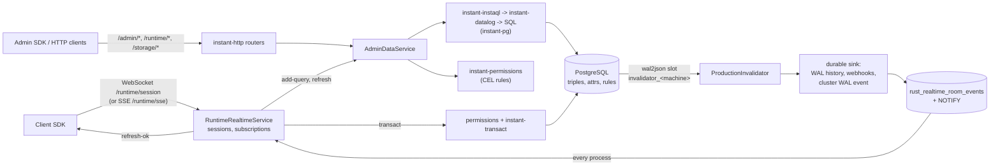
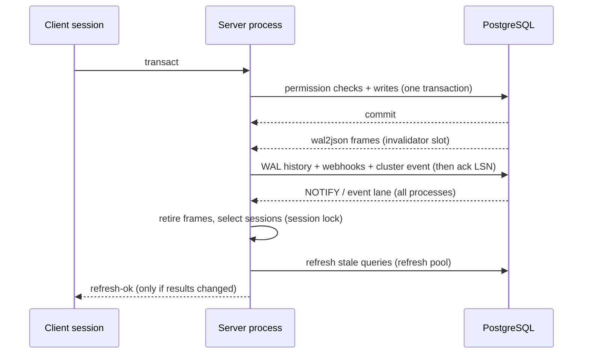

# Server architecture

This document describes how the BackendRelay server in [`server-rs/`](../server-rs) works. It is for contributors who change the server and for operators who need to know what a running process does.

BackendRelay is a fork of [InstantDB](https://github.com/instantdb/instant). Its backend has been rewritten in Rust, and BackendRelay is not affiliated with InstantDB. Applications use the standard `@instantdb/*` client SDKs, pointed at a BackendRelay server.

Names in `code` are Rust items or SQL objects. Follow the links to the source. Much of the server reproduces the behavior of the upstream JVM server, so comments in the code often call it "the JVM" or "the reference server".

## Overview



A write reaches PostgreSQL as triples. The server learns that it happened from logical replication, not from the write path. Every server process tails the WAL through its own replication slot. A committed transaction is persisted and published to a PostgreSQL-backed event lane, and each process then refreshes only the local subscriptions whose dependencies the write touched.

## 1. Components

### Process entry point

The binary is `instant-server`. Its entry point is [`main.rs`](../server-rs/crates/instant-server/src/main.rs).

| Command | What it does |
| --- | --- |
| `serve` (default) | Runs the HTTP server, the WAL invalidator, and the background workers. |
| `migrate up` / `migrate down [steps]` / `migrate force <version>` | Applies, rolls back, or force-sets schema migrations. `up` also runs `ensure_system_catalog`. |
| `healthcheck` | Sends `GET /health/system` to `127.0.0.1:$PORT` (default `8888`). It succeeds only on HTTP 200 with `{"wal":"ok"}`. |
| `generate-secrets` | Prints a fresh self-hosted secrets environment file. |
| `configure-byop <app-id>` | Reads a PostgreSQL URL from stdin, encrypts it, and stores it on `apps.connection_string` for a Bring Your Own Postgres (BYOP) app. |
| `flags list \| get <name> \| set <name> <json> \| unset <name>` | Reads or writes the deployment config app's flags through the native transaction path. |
| `failover` | Coordinates a database failover between the current and the next configured database. |

`serve` builds a multi-threaded Tokio runtime with 16 MiB worker stacks and assigns the process a random `machine_id`. It then resolves the database URL and builds the route assembly, described below. If `INSTANT_METRICS_ADDR` is set, it also starts the private metrics listener. Finally it binds the HTTP listener and hands everything to `run_production_server_process` in [`production_process.rs`](../server-rs/crates/instant-server/src/production_process.rs). That function runs HTTP, WAL invalidation, the periodic workers, and every PostgreSQL connection driver in one failure domain.

The process can rebuild itself. When a coordinated database failover completes, `serve` tears down the assembly and builds it again against the new database. Realtime sync history survives the rebuild.

Serving **verifies** migrations and the system catalog but never applies them. Run `instant-server migrate up` before you serve. Application SQL lives in [`instant-server/migrations/`](../server-rs/crates/instant-server/migrations) as numbered `<version>_<name>.up.sql`/`.down.sql` pairs that `build.rs` embeds in the binary. Migrations are append-only, because checksums detect drift in SQL that has already been recorded.

The server is self-hosted and cloud-neutral: it has no AWS SDK dependencies. AWS-only inputs such as Aurora cluster discovery or KMS-encrypted keysets are rejected at startup instead of being supported by an optional build.

### Route assembly

[`production_routes.rs`](../server-rs/crates/instant-server/src/production_routes.rs) wires the PostgreSQL-backed services into the `instant-http` routers. `build_production_routes_with_realtime_history` does the following, in order:

1. Opens the main workload-partitioned pool (see [section 6](#6-connection-pool-roles)) and a set of dedicated single-connection pools, one each for workers and policies such as `rate_limit`, `webhook_worker`, `realtime_room_writer`, `wal_durable_sink`, and `invalidation_control`.
2. Verifies migrations and the system catalog, and seeds the realtime watermark from `MAX(transactions.id)`.
3. Builds the services: `AdminDataService` (queries and transactions), `RuntimeRealtimeService` (WebSocket and SSE sessions), `AdminRealtimeService` (admin SDK subscriptions), and the auth, storage, dashboard, platform, and superadmin services. All of them share one `PostgresAdminDataAuthorizer` and one `RootFrameCaches` registry.
4. Builds the router with `instant_http::app_router_with_all_backends` ([`router.rs`](../server-rs/crates/instant-http/src/router.rs)). It then adds, in order: the app rate-limit middleware, the dynamic HTTP response (CORS/header) policy, and request tracing.
5. Ensures the per-process logical replication slot `invalidator_<machine_id>` and builds the `ProductionInvalidator`.
6. Collects the scheduled worker tasks: indexing, backups and restores, webhooks, replication-slot cleanup, partition retention, storage and rate-limit sweepers, the custodian, and others.

### Crates

| Crate | Role |
| --- | --- |
| [`instant-server`](../server-rs/crates/instant-server/src/lib.rs) | Process wiring, configuration, PostgreSQL-backed service implementations, the realtime runtime, background workers, migrations, metrics. |
| [`instant-http`](../server-rs/crates/instant-http/src/lib.rs) | HTTP/WebSocket/SSE protocol, middleware, and route groups. It defines backend traits (`AdminDataBackend`, `RuntimeRealtimeBackend`, and others) that `instant-server` implements. |
| [`instant-instaql`](../server-rs/crates/instant-instaql/src/lib.rs) | Coerces the public InstaQL object into typed forms and compiles them into Datalog match plans. Also compiles `where` clauses, query invalidation topics, and invalidation predicates. |
| [`instant-datalog`](../server-rs/crates/instant-datalog/src/lib.rs) | Pure Datalog planning over the triple indexes: CTE plans, pagination, SQL rendering, and result decoding. |
| [`instant-pg`](../server-rs/crates/instant-pg/src/lib.rs) | PostgreSQL execution primitives: InstaQL and Datalog execution, the wal2json replication connection and slot management, BYOP schema introspection, queries and topics, and attribute count-min sketches used for planning. |
| [`instant-permissions`](../server-rs/crates/instant-permissions/src/lib.rs) | CEL permission rules: query permission planning and pushdown, per-entity filtering, transaction checks, and rule-driven rate limits. |
| [`instant-transact`](../server-rs/crates/instant-transact/src/lib.rs) | Parses, validates, and executes the public transaction (write) protocol. |
| [`instant-wal`](../server-rs/crates/instant-wal/src/lib.rs) | Logical-WAL wire contracts: LSNs and ISNs (Instant sequence numbers), wal2json v2 entries, transaction assembly, and invalidation topics. |
| [`instant-realtime`](../server-rs/crates/instant-realtime/src/lib.rs) | Generic realtime building blocks: the single-flight query cache, invalidation epochs, topic matching, the session topic index, and room and presence state. |
| [`instant-auth`](../server-rs/crates/instant-auth/src/lib.rs) | Runtime auth primitives (magic codes, refresh tokens, app users) and OAuth 2.0 / OpenID Connect. |

CEL comes from the `cel` crate 0.14.3. [`server-rs/Cargo.toml`](../server-rs/Cargo.toml) patches it to the vendored copy in [`server-rs/vendor/cel`](../server-rs/vendor/cel), not the registry release.

## 2. Data model and query path

### Storage

All application data lives in one PostgreSQL schema as entity–attribute–value triples. The base tables are created in [`01_bootstrap.up.sql`](../server-rs/crates/instant-server/migrations/01_bootstrap.up.sql), and later migrations extend them.

- `apps`: one row per application.
- `attrs` and `idents`: the attribute catalog. Each attribute has an entity type and label, a value type (`ref` or `blob`), a cardinality, and unique and indexed flags. Links are `ref` attributes with forward and reverse identities.
- `triples`: `(app_id, entity_id, attr_id, value jsonb, value_md5)`, plus boolean index flags `ea`, `eav`, `av`, `ave`, `vae`. Partial indexes over those flags are the physical "indexes" that Datalog patterns target.
- `rules`: one `code jsonb` permission document per app.
- `transactions`: one row per committed write. The WAL consumer uses this row to recognize application transactions.

Built-in entities such as `$users`, `$files`, and refresh tokens are ordinary triples whose attributes belong to the system catalog. Runtime auth creates users and tokens through the normal transaction path (see [`instant-auth`](../server-rs/crates/instant-auth/src/lib.rs)).

Operational controls are also stored as triples, as `flags` entities of a config app (`INSTANT_CONFIG_APP_ID` in [`postgres_dashboard_policy.rs`](../server-rs/crates/instant-server/src/postgres_dashboard_policy.rs)). Examples are `coarse-topics-apps`, `disable-shared-root-frames`, and the invalidator batch and drop settings. The list of recognized toggles is in [`failover.rs`](../server-rs/crates/instant-server/src/failover.rs).

### From InstaQL to SQL

The native framework query path is `permissioned_framework_query_on_catalog_with_path` in [`admin_data.rs`](../server-rs/crates/instant-server/src/admin_data.rs). For one query it runs these steps:

1. **Prepare.** It applies the configured query modifiers, PostgreSQL settings, and planner options (`prepare_instant_query`).
2. **Snapshot.** It opens a `REPEATABLE READ`, read-only transaction. Query rows, permission entities, and `data.ref` lookups all read this one snapshot.
3. **Plan permissions.** `RuleSet::plan_query_permissions_async` ([`rule_where.rs`](../server-rs/crates/instant-permissions/src/rule_where.rs)) produces a `PermissionQueryPlan` containing pushdown constraints, fallback entity types, and rate limits (see [section 3](#3-permissions)).
4. **Compile.** `instant_instaql::coerce_forms` validates the query shape against the catalog. `compile_query_with_constraints` ([`nested.rs`](../server-rs/crates/instant-instaql/src/nested.rs)) then turns each root and nested form into a `CompiledNode` of Datalog patterns, with the permission constraints injected.
5. **Plan and render SQL.** `instant-datalog` builds one CTE per pattern, joined on shared symbols ([`cte.rs`](../server-rs/crates/instant-datalog/src/cte.rs)), adds page-boundary CTEs ([`pagination.rs`](../server-rs/crates/instant-datalog/src/pagination.rs)), and renders the whole plan as a single parameterized statement ([`sql.rs`](../server-rs/crates/instant-datalog/src/sql.rs)). Values are only ever positional parameters. Identifiers are validated and quoted.
6. **Execute.** `instant_pg::query_instaql*` ([`instant-pg/src/lib.rs`](../server-rs/crates/instant-pg/src/lib.rs)) runs the statement, optionally with typed parameters or bounded per-connection prepared plans, and decodes the JSON envelope into `ExecutedNode` trees. Attribute count-min sketches (`attr_sketches`) feed cardinality estimates. They choose the plan shape, never which rows are returned.
7. **Filter and shape.** File URLs are signed. The entity data that the permission rules need is loaded, and every returned entity is checked with CEL. Rule-driven rate limits are consumed, invalidation topics are computed from the filtered result, and the response is shaped.

### Transactions

A write arrives as `transact` on a realtime session, or at `POST /admin/transact`.

- [`instant-permissions/src/transaction.rs`](../server-rs/crates/instant-permissions/src/transaction.rs) (`execute_permissioned_transaction`) runs the permission checks and the writes in **one** PostgreSQL transaction. A denied pre-write or post-create check rolls it back.
- [`instant-transact`](../server-rs/crates/instant-transact/src/lib.rs) compiles the steps: `add-triple`, `deep-merge-triple`, `retract-triple`, `delete-entity`, and the `add-attr`/`update-attr`/`delete-attr`/`restore-attr` schema steps. It resolves lookups and executes them in order ([`execute.rs`](../server-rs/crates/instant-transact/src/execute.rs)). It first inserts the `transactions` row and sets `instant.wal_msg_app_id`. The triggers on `triples` (latest definitions in [`114_triples_size_updates_table.up.sql`](../server-rs/crates/instant-server/migrations/114_triples_size_updates_table.up.sql)) then emit transactional logical messages (`update_ents` / `delete_ents`) with post-transaction entity snapshots. Required attributes are validated before commit.
- After commit, the realtime `transact-ok` reply waits briefly (up to 2.5 s, bounded by the receive deadline) for the WAL stream to report the commit's ISN. If the ISN does not arrive in time, it falls back to an ISN derived from `pg_current_wal_insert_lsn()`.

## 3. Permissions

Rules are the app's `rules.code` JSON. Each rule expression is compiled with CEL. Compilation artifacts are memoized ([`compiled_programs.rs`](../server-rs/crates/instant-permissions/src/compiled_programs.rs)), but decisions are never cached.

For queries, [`instant-permissions`](../server-rs/crates/instant-permissions/src/lib.rs) works in three stages:

- **Planning and pushdown.** `rule_where.rs` evaluates `view` rules symbolically and turns what it safely can into InstaQL `where` constraints. `compile_query_with_constraints` applies those constraints to every root or nested form of the matching entity type, so PostgreSQL does not return rows the user cannot see. Expressions that cannot be represented become `fallback_etypes`. `data.ref(...)` lookups that planning needs are loaded in the query snapshot.
- **Entity loading.** `query_permission_entity_loads` decides which entities, and which attributes, the rules need. [`attribute_projection.rs`](../server-rs/crates/instant-permissions/src/attribute_projection.rs) proves statically when a rule reads only selected fields, so only those attributes are loaded. Any other use falls back to loading the complete entity.
- **Per-entity evaluation.** Pushdown is an optimization, not the security boundary. After SQL runs, the full post-query pass still evaluates the `view` (and field) rules for every returned entity (`prepare_*_query_permissions` followed by `filter`). Denied entities are removed before the response is shaped.

The `admin` actor bypasses rules. Admin HTTP requests can impersonate a user with the `as-token`, `as-email`, or `as-guest` headers, and those requests are evaluated like that user's.

## 4. Realtime pipeline

### Sessions

[`instant-http/src/runtime_realtime.rs`](../server-rs/crates/instant-http/src/runtime_realtime.rs) serves `GET /runtime/session` (WebSocket) and `/runtime/sse` (GET opens a stream, POST pushes messages). It enforces frame-size limits, inbound byte budgets, and ping liveness, then hands messages to `RuntimeRealtimeService` in [`instant-server/src/runtime_realtime.rs`](../server-rs/crates/instant-server/src/runtime_realtime.rs).

- Sessions live in one process-wide `SessionRegistry` ([`runtime_realtime/session_registry.rs`](../server-rs/crates/instant-server/src/runtime_realtime/session_registry.rs)), indexed by app. This document calls its mutex the **session lock**. WAL selection and query registration both run under it.
- Handled ops include `init`, `add-query`, `remove-query`, `transact`, the room ops (`join-room`, `leave-room`, `set-presence`, `client-broadcast`), sync-table ops, and stream ops.
- Each session has its own refresh worker with a bounded inbox (128) and a bounded outbound queue (256).
- Rooms and presence ([`instant-realtime/src/room.rs`](../server-rs/crates/instant-realtime/src/room.rs)) are shared across processes by `PostgresRealtimeCluster` ([`postgres_realtime_cluster.rs`](../server-rs/crates/instant-server/src/postgres_realtime_cluster.rs)), using PostgreSQL tables plus `LISTEN`/`NOTIFY`.

### Subscriptions (`add-query`)

`add-query` registers a subscription in these steps:

1. Captures the app's query epoch and processed watermark, so the reported watermark belongs to the query's start, not its completion.
2. Executes the query through the per-app session result cache on the **interactive** workload (see [Session result cache](#session-result-cache-and-epochs)).
3. Computes the query's dependency topics (precise, or coarse for apps listed in `coarse-topics-apps`) and, when the query shape supports one, an entity-level invalidation predicate ([`invalidation_predicate.rs`](../server-rs/crates/instant-instaql/src/invalidation_predicate.rs)).
4. Under the session lock: if the app's security epoch changed during execution, it re-runs the query. Otherwise it registers the query in the `SessionTopicIndex`. If a logged data invalidation since step 1 may affect the query, it marks the query stale and queues a catch-up refresh. It then replies `add-query-ok` with the result and the step 1 watermark.

### WAL stream

Each process consumes its own permanent logical slot, `invalidator_<machine_id>`. The slot is created or adopted with `ensure_logical_replication_slot` ([`instant-pg/src/replication_slot.rs`](../server-rs/crates/instant-pg/src/replication_slot.rs)) and streamed over `Wal2JsonReplicationConnection` ([`instant-pg/src/replication.rs`](../server-rs/crates/instant-pg/src/replication.rs)) with wal2json options `format-version 2`, `include-lsn`, and an `add-tables` filter. The filter (`SlotPurpose::Invalidator` in [`instant-wal/src/replication.rs`](../server-rs/crates/instant-wal/src/replication.rs)) covers `idents`, `triples`, `attrs`, `transactions`, `rules`, `apps`, `instant_users`, the `wal_logs` partitions, and `webhooks`.

The stream is processed in this order:

1. `WalInvalidationPipeline` ([`instant-realtime/src/replication.rs`](../server-rs/crates/instant-realtime/src/replication.rs)) decodes the frames, assembles each committed transaction that carries a `transactions` row into a `WalRecord` (triple, ident, and attr changes, logical messages, and `wal_logs` rows), and emits raw-row cache evictions for `attrs`, `rules`, and `apps` changes.
2. The durable sink, `PostgresDurableInvalidationSink` in [`wal_history.rs`](../server-rs/crates/instant-server/src/wal_history.rs), writes WAL history, matching webhook queue rows, and the cluster WAL event together. Records already available from the transport are grouped, up to 32 records, 1,024 frames, or 1 MiB per group (`run_invalidation_stream` in [`replication.rs`](../server-rs/crates/instant-server/src/replication.rs)).
3. Only after that does the pipeline acknowledge the LSN. Standby feedback never moves past the durable position. After a reconnect, the stream resumes from the slot's confirmed flush LSN.

Abandoned per-machine slots are dropped after a grace period by the slot cleaner ([`replication_slot_cleanup.rs`](../server-rs/crates/instant-server/src/replication_slot_cleanup.rs)).

The same process also runs two other WAL consumers:

- A singleton `aggregator` slot over `public.triples` maintains the attribute sketches.
- A BYOP reconciler runs one slot (`instant_byop_<app>`) per configured external database.

### Cross-process delivery

The cluster WAL event is inserted into `rust_realtime_room_events` through the sink's own `wal_durable_sink` connection, so presence and broadcast writes on `realtime_room_writer` cannot delay it. It is deduplicated per `(app, ISN)` and announced with `pg_notify`. Every process, including the publisher, consumes that event lane in order, using a per-machine cursor, `LISTEN` wakeups, and a 1-second safety poll. Consecutive WAL events are grouped into windows of up to 128 records (`MAX_WAL_REFRESH_BATCH`). Up to 32 windows may be in flight before acknowledgement (`MAX_WAL_REFRESH_WINDOWS`). One session refresh is bounded by `INSTANT_WAL_SINK_REFRESH_DEADLINE_MS` (10 s by default); a refresh that exceeds it fails for that session and the window still completes. The session then forces its own refresh after a 1 s backoff that doubles per consecutive timeout, capped at 30 s and reset by a successful refresh, so a deadline hit converges without waiting for another WAL event.



### Selecting subscriptions

A WAL topic is an `[indexes e a v]` tuple, where each component is a wildcard or a finite set. `topics_for_record` ([`instant-wal/src/topics.rs`](../server-rs/crates/instant-wal/src/topics.rs)) derives topics from each triple insert, delete, or update (old and new values), and from ident and attribute changes.

For each record in a window, `prepare_wal_record_for_sessions` and `select_wal_refresh_sessions` in [`runtime_realtime.rs`](../server-rs/crates/instant-server/src/runtime_realtime.rs) do the following:

1. Skip apps with no local sessions. Sync history is still recorded for them.
2. Retire the app's shared root frames **before** taking the session lock (see [section 5](#5-shared-root-frames)).
3. Under the session lock: retire session-result reuse for the app and record the query epoch, advance the processed watermark, and get candidate sessions from the `SessionTopicIndex` ([`subscription_index.rs`](../server-rs/crates/instant-realtime/src/subscription_index.rs)). The index is a conservative reverse index over entity, attribute, and value sets. Unknown or large dependency sets fall back to a scan.
4. For each candidate query: if `topics_intersect` ([`topic.rs`](../server-rs/crates/instant-realtime/src/topic.rs)) finds no overlap, the query is skipped. If the query has an invalidation predicate, the predicate is evaluated against the before and after entity images reconstructed from the trigger messages. A query with no predicate refreshes conservatively. Each selected query is marked with a new stale generation.

A schema change refreshes every query of the app's sessions and resends attributes. Schema changes are attribute inserts or deletes, any ident change, and a `triples` truncate (`wal_schema_refresh`). Separately, any `rules`, `attrs`, or `apps` row change clears the app's caches as a security event, and app status changes are pushed to sessions as `app-status-changed`. Within a window, each selected session is refreshed once, at the window's latest transaction.

### Refresh batching and admission

Each session's refresh worker:

- Coalesces queued refreshes and honors a no-op throttle deadline (`refresh_throttle`).
- Acquires a slot from `RefreshAdmission` ([`refresh_admission.rs`](../server-rs/crates/instant-server/src/runtime_realtime/refresh_admission.rs)): FIFO within an app, round-robin between apps. Production sets the maximum number of active refreshes to twice the refresh pool partition's size, with 16,384 waiters. When both are full, the refresh fails with a rate-limited error.
- Reads the refresh catalog and refresh controls (app status, coarse-topic flag), then re-executes the session's stale queries on the **refresh** workload. For native apps each query goes through the session result cache. BYOP apps execute as one batch against the external database.
- Sends `refresh-ok` only for results that changed, or when attributes changed. A no-op refresh can set a delay before that session's next refresh.

Metrics for this stage include `backendrelay_refresh_active`, `backendrelay_refresh_waiting`, and `backendrelay_refresh_admission_rejections_total`.

### Session result cache and epochs

The generic `QueryCache` ([`instant-realtime/src/cache.rs`](../server-rs/crates/instant-realtime/src/cache.rs)) is a single-flight async cache. Concurrent callers for one key share one loader, and dropping the last waiter cancels the load. Entries are weight-bounded with LRU eviction and have a TTL. Optional per-app and process-wide in-flight limits make an overloaded lookup fail fast.

The runtime keeps one session result cache per app ([`runtime_realtime/query_cache.rs`](../server-rs/crates/instant-server/src/runtime_realtime/query_cache.rs)):

- **Key:** actor, canonical query, return type, and SDK versions. Results are post-permission, so they are reused only by the same actor.
- **Settings:** read from the config app (`DatalogCachePolicy`) when the app's cache is created. Defaults are a 1-hour TTL and a 500 MiB weight budget.
- **Process-wide cap:** every app's cache also joins one process-wide ready-byte budget. It defaults to a quarter of the container memory limit, at most 4 GiB, and can be set with `INSTANT_RESULT_CACHE_MAX_BYTES`. When the sum exceeds it, the globally least recently used entries are evicted across apps. Shared root frames join the same budget, so their ready bytes are charged to it and reported separately by `backendrelay_root_frame_cache_bytes`. `backendrelay_result_cache_bytes` and `backendrelay_result_cache_evictions_total` report the budget as a whole.
- **On a data WAL:** every reusable result for the app is retired. A permission-filtered result's topics can omit hidden dependencies, so no result is kept selectively. Waiters already attached to an in-flight load still receive its value, but that value is not cached.
- **On a security change** (rules, attributes, app status): the cache is cleared and in-flight loads are cancelled.

[`instant-realtime/src/epoch.rs`](../server-rs/crates/instant-realtime/src/epoch.rs) keeps per-app data and security counters, plus a bounded log of the last 1,024 invalidations with their topics. `add-query` uses this log to decide whether a write that raced its execution can affect it. A window older than the log, or an invalidation with imprecise routing, is answered conservatively. Two independent registries exist: `query_epochs` for session results and `frame_epochs` for shared root frames.

## 5. Shared root frames

Many sessions often subscribe to the same query. The query result after permissions are applied depends on the user. The SQL result before permissions often does not. Shared root frames let one subscription refresh reuse that pre-permission work across sessions. They are implemented in [`root_frames.rs`](../server-rs/crates/instant-server/src/root_frames.rs) (mounted as `admin_data::root_frames`), [`root_frame_cache.rs`](../server-rs/crates/instant-server/src/root_frame_cache.rs), and `AdminDataService::shared_root_frames` in [`admin_data.rs`](../server-rs/crates/instant-server/src/admin_data.rs).

**What a frame is.** A `RootFrame` holds the pre-permission result for **one** top-level root of a native framework query, after the file-URL transform. It also holds the entity data that the root's permission checks need, and the root's invalidation topics. It contains no authorization decisions, session bindings, shaped response, or signed output.

**Cache key.** Frames are cached per app. `RootFrameKey` is built from the app, a catalog digest, the native/external flag, a digest of the rule code, the single-root compiled query **after** permission pushdown, the planner options, the PostgreSQL settings, and the attribute-projection flag. It never includes a session or an actor. If pushdown embeds values from `auth`, users with different values get different keys automatically. Any rule edit changes every key.

**Eligibility** (`root_frames::eligible`). The app is native (not BYOP), the actor is not `admin`, the permission plan has no rate limits, the query executes SQL, and the rule programs need no database callbacks during evaluation.

**When the shared cache is used:**

- Only subscription refreshes, meaning work on `DatabaseWorkload::Refresh`, read or populate it. Each cache miss loads its root in its own `REPEATABLE READ` snapshot and connection. Concurrent sessions that need the same root join that load.
- An initial `add-query` (interactive workload) uses per-request frames. It executes all roots in one statement in its own snapshot, splits the result per root, and never touches the shared cache, so a one-off read cannot create an entry nobody looks up again.
- Apps in `coarse-topics-apps` refresh without the shared cache (`without_shared_root_frame_reuse`). Coarse routing topics do not match the precise topics that frames retire on.
- The `disable-shared-root-frames` config toggle turns cross-session reuse off and keeps the per-request frame path.

**Evaluation by reference.** Each session evaluates permissions against each shared frame by reference (`prepare_borrowed_query_permissions`), with no copy of the frame's tree or entity map. Every session still runs the full CEL filter itself. Entity data from different roots is never merged, because frames can come from different snapshots.

**Invalidation topics.** A frame's topics come from its *unfiltered* executed node, plus an entity-level topic for every permission entity it carries. A rule can read an attribute that the query never selected. If no precise topics can be computed, the topics are `None`, and the frame is retired by every data WAL.

**Retiring frames on a data WAL.** `invalidate_app_root_frames` records the WAL in the app's `frame_epochs` and calls `retire_wal_deferred`, which removes only ready frames whose topics intersect the WAL. A cheap pre-filter rejects a frame before the full `topics_intersect` scan when the frame and the WAL share no attribute or entity UUID, and neither side uses a wildcard. This happens **before**, and outside, the session lock. Refreshes are dispatched only after selection marks sessions under that lock, so a selected refresh can never read a frame that its WAL affects. The registry mutex is released before scanning, so one app's retirement does not block another app's lookups. Retired payloads are dropped after locks are released.

**Loads already in flight.** An in-flight load is detached from new joiners but not cancelled. When it completes, it is published to the cache only if the frame epoch proves that no invalidation since the load began was a security change, was imprecise, intersected the frame's topics, or fell off the bounded log. The epoch is checked again under the cache lock before insertion.

**Security changes** (rules, schema, app status) clear the app's frames and cancel in-flight loads. A request whose shared load is cancelled this way, by cluster-lag recovery, or by cache removal falls back to a **private** load in its own fresh snapshot, which is never published.

**Expiry.** A frame lives at most 5 seconds (`ROOT_FRAME_MAX_AGE`, which caps the configured TTL). Topics come from the rows a frame returned, so some changes are invisible to them, such as a sort-key update that moves an out-of-page entity onto the page. The short lifetime bounds that staleness. Sharing is meant to happen within one write's refresh fan-out.

When an app's last session disconnects, its frame cache and frame epochs are removed. Cumulative counters are kept and exported as `backendrelay_root_frame_cache_{entries,bytes,hits_total,misses_total,loads_total,retire_scanned_total,retire_retired_total,retire_nanos_total,expired_total}`. The ready bytes are also charged to the process-wide result-cache budget, so a full budget evicts the least recently used frames across apps.

## 6. Connection pool roles

`PostgresPool::connect_workload_partitioned` ([`postgres_pool.rs`](../server-rs/crates/instant-server/src/postgres_pool.rs)) splits `CONNECTION_POOL_SIZE` (default 20, or 400 in hosted environments) into three partitions without adding connections. `workload_capacities` computes the split:

```text
control     = min(total / 4, total - 7)
refresh     = min((total - control) / 2, total - control - 6)
interactive = total - refresh - control
```

At the default of 20, this gives 8 interactive, 7 refresh, and 5 control connections. Below 8 connections, the pool is not partitioned.

| Role | Used by |
| --- | --- |
| **interactive** | The default `DatabaseWorkload`: initial `add-query`, transactions, admin HTTP queries, and other request work. At least six slots are always reserved. |
| **refresh** | Work scoped with `DatabaseWorkload::Refresh`: WAL batch preparation, subscription refresh queries, and shared root frame loads. The task-local workload is captured and re-entered across spawned cache loaders. |
| **control** | Fresh per-operation policy reads that gate data queries: app status, rate limits, refresh throttle and coarse-topic flags, query controls and failover gate, transaction-authorization catalog reads, the HTTP response policy, and the WAL readiness check behind `/health/system`. |

The partitions keep each kind of work from starving the others:

- A refresh storm after a popular write cannot consume the connections that new subscriptions and writes need.
- Policy reads never queue behind the data queries they authorize.
- Readiness stays accurate while data pools are saturated.

Refresh admission is sized from the refresh partition, so excess refresh work waits in memory instead of in the pool's queue.

Besides the partitioned pool, assembly opens dedicated single-connection pools for individual workers and policies. It also opens the replication connections, the cluster `LISTEN` connection, and (for BYOP apps) connections to external databases. The process therefore uses noticeably more PostgreSQL connections than `CONNECTION_POOL_SIZE`. Pool metrics are labeled by role, for example `backendrelay_pool_waiting_by_role{role="refresh"}`.

## 7. Other services

- **Runtime auth** ([`instant-auth`](../server-rs/crates/instant-auth/src/lib.rs), [`runtime_auth.rs`](../server-rs/crates/instant-server/src/runtime_auth.rs), [`runtime_oauth.rs`](../server-rs/crates/instant-server/src/runtime_oauth.rs)). Magic codes, guest sign-in, refresh tokens (stored hashed), sign-out, and OAuth/OpenID Connect flows. The routes are `/runtime/auth/*`, `/runtime/oauth/*`, `/runtime/{app_id}/oauth/*`, and `/runtime/{app_id}/.well-known/openid-configuration`.
- **Storage** ([`s3_storage.rs`](../server-rs/crates/instant-server/src/s3_storage.rs), [`admin_storage.rs`](../server-rs/crates/instant-server/src/admin_storage.rs)). Objects live in an S3-compatible bucket. `S3_ENDPOINT` is required and no provider is inferred: use R2, AWS S3, or another S3-compatible service. Signed upload and download URLs back `/storage/*` and `/admin/storage/*`, and file metadata is stored as `$files` entities. Backups use a separate bucket (`S3_APP_BACKUPS_BUCKET`). When a file's triples are deleted, a trigger queues its object, and the storage sweeper deletes it after a grace period.
- **Email** ([`email_router.rs`](../server-rs/crates/instant-server/src/email_router.rs)). Transactional email, such as magic codes, goes through Postmark, SendGrid, Resend, or Cloudflare. The provider is selected by `INSTANT_EMAIL_PROVIDER`, or detected from whichever provider tokens are configured.
- **Admin HTTP API** (`/admin/*`). Queries, transactions, permission checks, schema, users, presence, storage, and admin SDK subscriptions (`/admin/subscribe-query`, `/admin/sse`, served by `AdminRealtimeService`). Requests carry an `app-id` and an app admin bearer token.
- **Management APIs**: the dashboard API (`/dash/*`), `/superadmin/*`, and the platform OAuth endpoints (`/platform/oauth/*`). When `INSTANT_DASHBOARD_GATEWAY_TOKEN` is set, this group requires the `x-instant-dashboard-gateway-token` header ([`dashboard_gateway.rs`](../server-rs/crates/instant-http/src/dashboard_gateway.rs)). Setting `INSTANT_DASHBOARD_PRIVATE=true` makes the token mandatory. Normal user authorization still applies after the gateway check.
- **Webhooks.** Webhook rows are queued atomically with WAL history and delivered by `PostgresWebhookWorker`. Payloads are signed, and the public keys are served at `/.well-known/webhooks/jwks.json`.
- **Metrics** ([`metrics.rs`](../server-rs/crates/instant-server/src/metrics.rs)). A private Prometheus endpoint, `GET /metrics`, runs on a separate listener that starts only when `INSTANT_METRICS_ADDR` is set. That address must be loopback with a non-zero port; `INSTANT_METRICS_ALLOW_NONLOOPBACK=true` additionally permits a private, IPv6 unique-local, or unspecified bind for a private container network. Nothing is added to the application router. All metric names start with `backendrelay_`, for example `backendrelay_up`, `backendrelay_http_requests_total`, `backendrelay_pool_acquisition_seconds`, and `backendrelay_sessions`. Labels come from a fixed vocabulary, never from request data.
- **Health.** `GET /health/system` returns `200 {"wal":"ok"}` when this process's invalidation stream is healthy and no process has published a WAL failure marker ([`postgres_wal_health.rs`](../server-rs/crates/instant-server/src/postgres_wal_health.rs)). Otherwise it returns `500 {"wal":"error"}`. `instant-server healthcheck` wraps this check for container health probes. `GET /health/version` reports the embedded release version, git revision and latest migration version, and is not part of readiness. `GET /` returns a static banner.
- **Bring Your Own Postgres.** Apps configured with `configure-byop` are queried against their introspected external schema ([`instant-pg/src/byop*.rs`](../server-rs/crates/instant-pg/src/byop.rs)). Each has its own replication slot on the external database. Shared root frames never apply to them.
